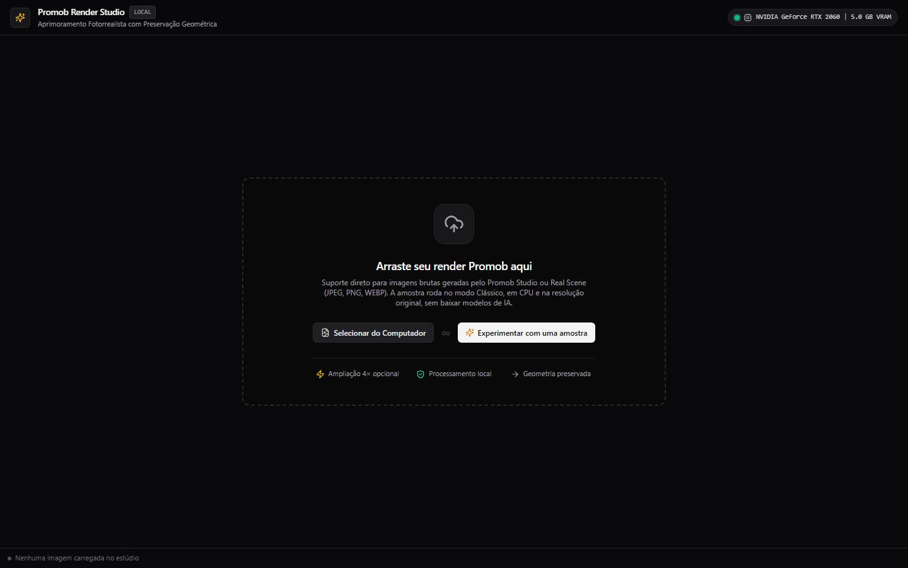
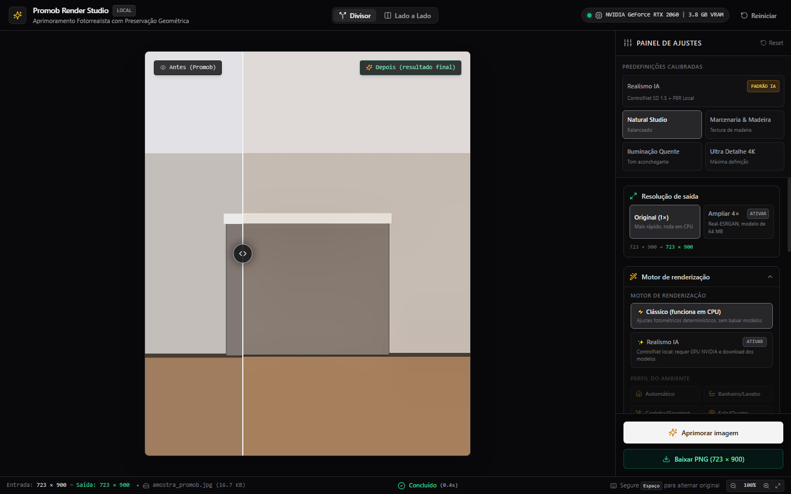
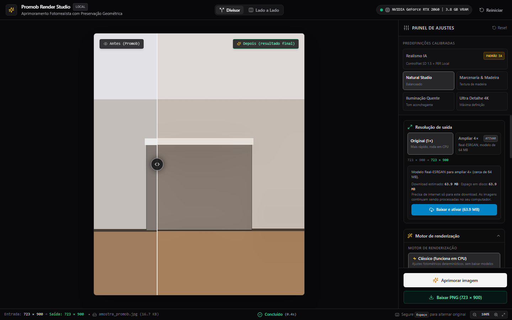
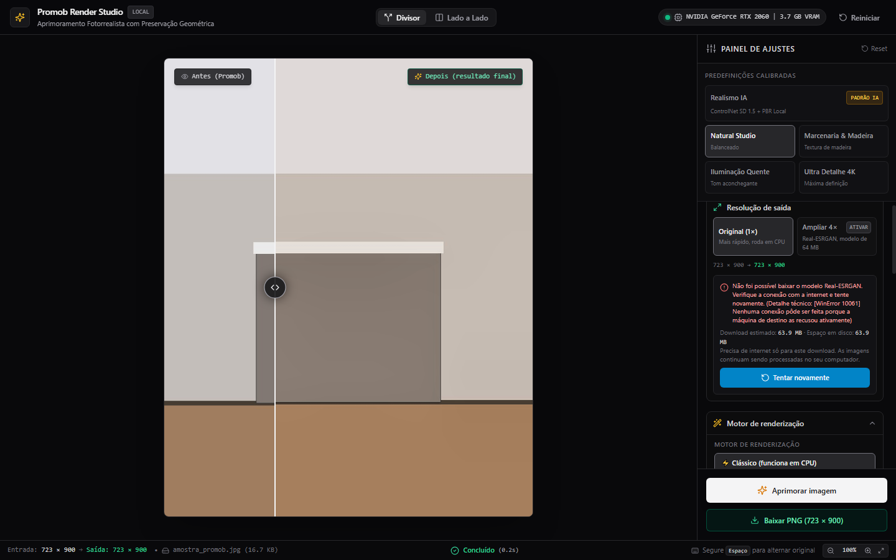
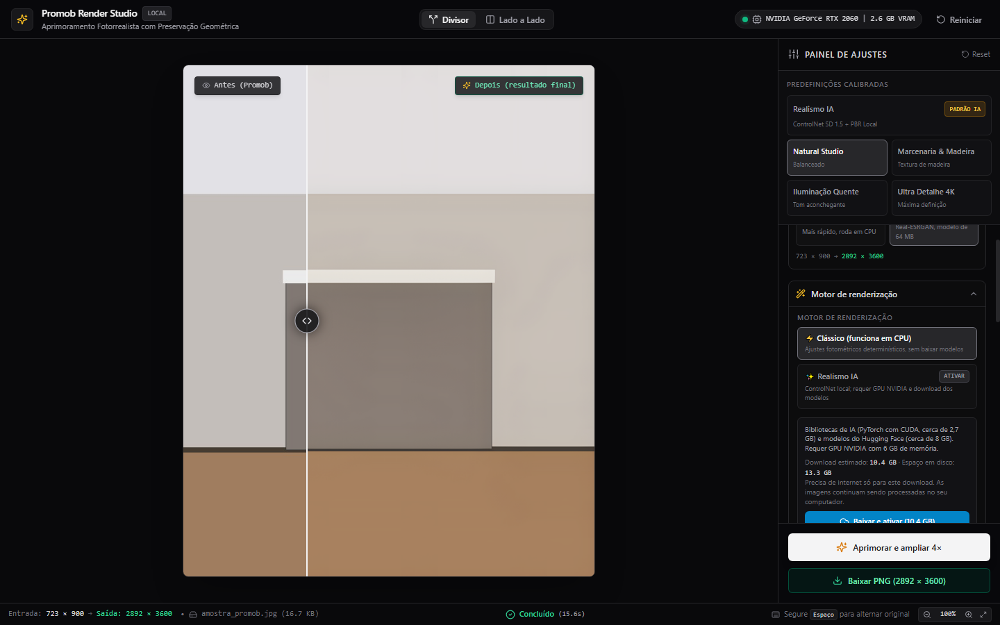
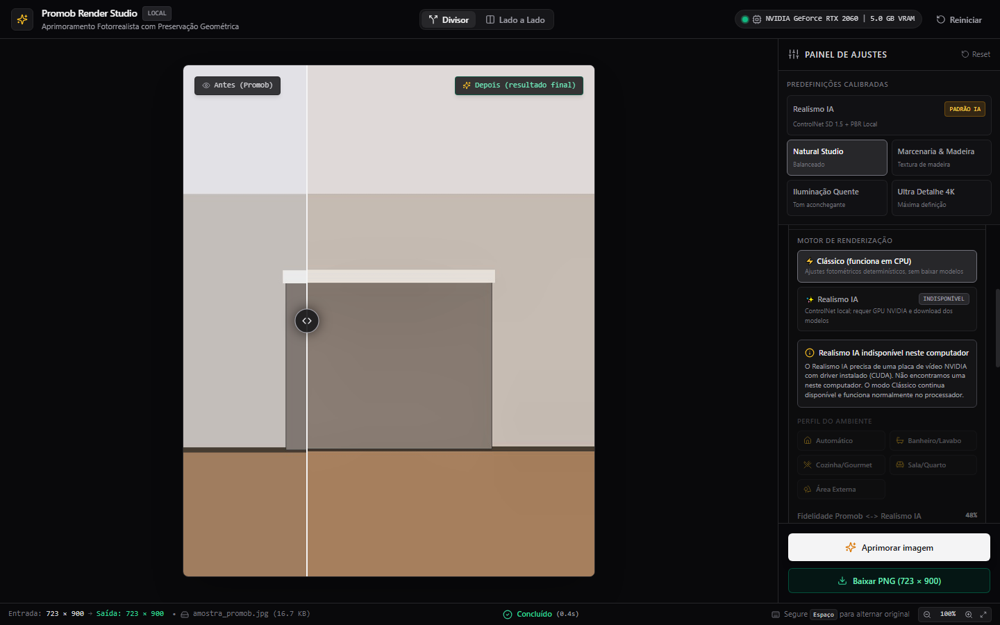
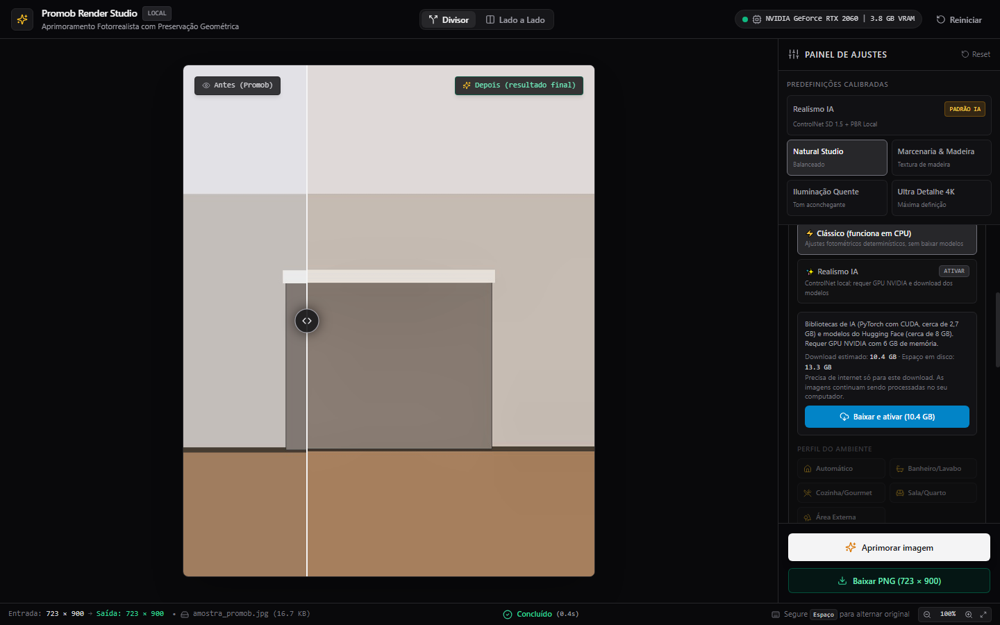
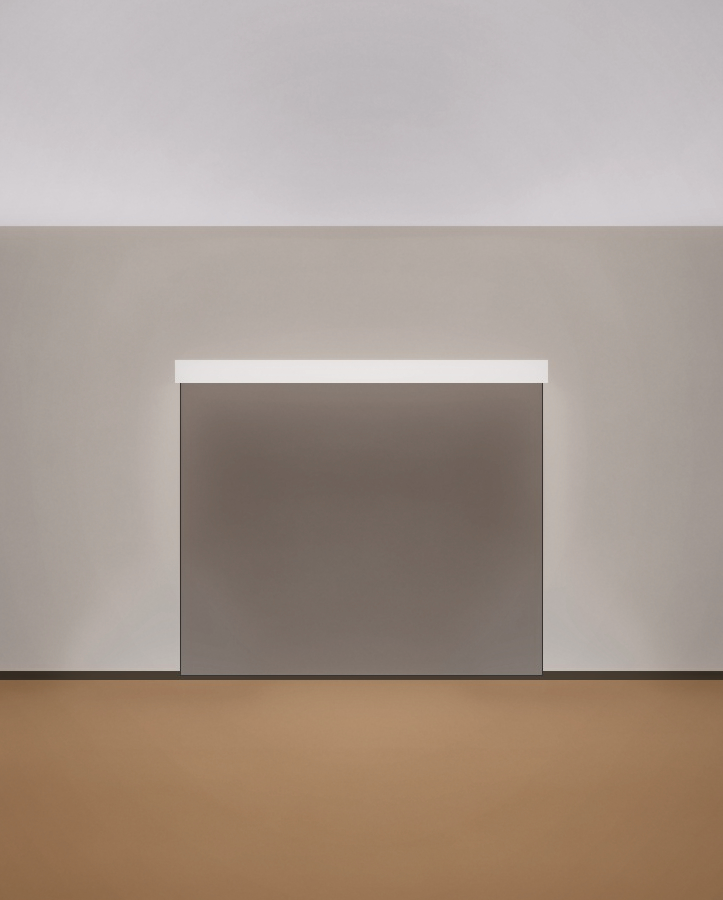

# Promob Render Studio

Aprimore imagens renderizadas no Promob com um aplicativo local, gratuito e de código aberto. Compare o antes e o depois no navegador, ajuste a iluminação e os materiais e exporte o resultado em PNG.

| Modo | Quando usar |
| --- | --- |
| **Clássico** | Ajuste exposição, balanço de branco, sombras, contraste e nitidez com processamento determinístico. Pode rodar em CPU. |
| **Realismo IA** | Reilumine a cena com modelos locais, incluindo efeitos de spots, fitas de LED e lareira quando detectados. O processamento procura preservar geometria, materiais, objetos e textos. Revise o resultado antes de entregar. |

A ampliação 4× é opcional e multiplica cada lado por 4. Um render de 1024 × 698, por exemplo, resulta em 4096 × 2792.

## Baixar para Windows

[](https://github.com/LuizGabrielCN/promob-render-studio/releases/latest/download/PromobRenderStudio-Setup.exe)

Para Windows 10 ou 11 de 64 bits. Não precisa de terminal, Git, Python ou Node.js e não pede senha de administrador.

1. Baixe o `PromobRenderStudio-Setup.exe` pelo botão acima ou na página [Releases](https://github.com/LuizGabrielCN/promob-render-studio/releases/latest).
2. Abra o instalador e conclua as etapas. O app abre no navegador ao final. Depois, use **Promob Render Studio** no menu Iniciar.
3. Clique em **Experimentar com uma amostra**. O app processa uma cena de exemplo no modo Clássico, na resolução original, usando o processador. Compare o antes e o depois arrastando o divisor e clique em **Baixar PNG**.

O app roda no seu computador, no endereço `http://127.0.0.1`, e não fica acessível pela rede. Para fechar, use **Encerrar Promob Render Studio** no menu Iniciar.

> O instalador ainda não tem assinatura digital, então o Windows SmartScreen pode avisar que o editor é desconhecido. Baixe apenas pela página oficial de Releases e, se quiser conferir o arquivo, compare o SHA-256 publicado junto com ele: `Get-FileHash .\PromobRenderStudio-Setup.exe -Algorithm SHA256`.

### Quando precisa de internet

- Para baixar o instalador.
- **Não** precisa para o primeiro teste: a amostra, o modo Clássico e o download do PNG funcionam sem conexão.
- Só quando você escolher um recurso extra no painel. O app mostra o tamanho antes de baixar:
  - **Ampliar 4×**: modelo de cerca de 64 MB.
  - **Realismo IA**: bibliotecas de IA (cerca de 2,7 GB) e modelos (cerca de 8 GB). Antes de baixar, o app confere se há uma placa de vídeo NVIDIA compatível. Sem ela, explica o motivo e o modo Clássico continua disponível.

Se um download falhar, clique em **Tentar novamente**. Mesmo depois de baixar os modelos, as imagens continuam sendo processadas no seu computador.

### Espaço em disco

| O que | Espaço aproximado |
| --- | --- |
| App instalado (modo Clássico) | 520 MB |
| Ampliação 4× | + 64 MB |
| Realismo IA | + 5,5 GB de bibliotecas e + 8 GB de modelos |

### Desinstalar

Abra **Configurações > Aplicativos > Aplicativos instalados**, procure **Promob Render Studio** e escolha **Desinstalar**. O desinstalador fecha o app, remove o programa, as bibliotecas de IA, o cache de imagens e os logs. No final, ele pergunta se você também quer apagar os modelos baixados.

## Como funciona

Capturas geradas pelo teste visual automatizado ([`scripts/ui_walkthrough.py`](scripts/ui_walkthrough.py)) a partir do app instalado, num perfil sem modelos baixados.

| | |
| --- | --- |
|  **1.** Tela inicial |  **2.** Amostra processada em CPU, com o divisor antes/depois e o botão **Baixar PNG** |
|  **3.** A ampliação 4× mostra o tamanho antes de baixar |  **4.** Sem conexão, o download falha com uma explicação e **Tentar novamente** |
|  **5.** Depois da nova tentativa, o resultado sai em 4× (2892 × 3600) |  **6.** Sem GPU NVIDIA, o Realismo IA explica o motivo e o Clássico continua disponível |
|  **7.** Com GPU NVIDIA, o Realismo IA mostra o download estimado antes de começar |  **8.** Amostra processada pelo Realismo IA numa RTX 2060 de 6 GB, depois da ativação pelo app |

## Instalação pelo código-fonte

Use Windows, Python 3.11 e Node.js 24 LTS no fluxo recomendado. Instale [Git](https://git-scm.com/downloads), [uv](https://docs.astral.sh/uv/getting-started/installation/) e [Node.js](https://nodejs.org/download). O Realismo IA foi testado com uma NVIDIA RTX 2060 de 6 GB de VRAM. Ele requer CUDA, driver compatível e espaço para baixar vários gigabytes de modelos. A compatibilidade com outras combinações de sistema e GPU pode variar.

```powershell
git clone https://github.com/LuizGabrielCN/promob-render-studio.git
cd promob-render-studio
uv sync --project backend --python 3.11 --locked
npm --prefix frontend ci
npm --prefix frontend run build
uv run --project backend --locked python run.py
```

Abra [http://127.0.0.1:8000](http://127.0.0.1:8000) se o navegador não abrir automaticamente. Depois da instalação, você também pode usar `start.bat` no Windows. O `uv sync` instala também as bibliotecas do Realismo IA (grupo `ai`). Para instalar só o núcleo do modo Clássico, use `uv sync --project backend --locked --no-group ai`.

### Ativar Realismo IA

Execute na raiz do projeto e reinicie o aplicativo após o download. Você também pode baixar os modelos pelo painel do app.

```powershell
uv run --project backend --locked python backend/scripts/download_models.py --required
uv run --project backend --locked python backend/scripts/download_models.py --verify-only
```

A instalação das dependências e a primeira aquisição dos pesos precisam de internet. O Realismo IA usa os modelos do cache local. Depois que os pesos estiverem disponíveis, o render roda na sua máquina, sem enviar a imagem para um serviço de inferência.

## Primeiro render

1. Exporte uma imagem do Promob em JPG, PNG ou WebP. Você também pode usar **Experimentar com uma amostra** para testar com a cena sintética incluída.
2. Abra a imagem no aplicativo, escolha um preset e ajuste os controles. Para começar com **Realismo IA**, experimente intensidade de **48%** e perfil **Auto**.
3. Escolha a resolução de saída (**Original** ou **Ampliar 4×**), clique em **Aprimorar** e confira o resultado no comparador. A prévia rápida mostra ajustes fotométricos. A reiluminação neural e a ampliação aparecem no render final.
4. Baixe o PNG e confira detalhes como veios, emendas, objetos e letras pequenas antes de usar a imagem numa apresentação.

## Documentação

- [Guia de uso e solução de problemas](docs/uso.md)
- [Instalador para Windows: decisões, build e testes](docs/instalador-windows.md)
- [Arquitetura, API e modelos](docs/arquitetura.md)
- [Como contribuir e executar testes](CONTRIBUTING.md)

## Licença

O código e a documentação deste projeto usam a [licença MIT](LICENSE). Os pesos e demais dependências mantêm as licenças dos respectivos projetos. Consulte a [relação de modelos](docs/arquitetura.md#modelos-e-licenças).

Projeto independente. Promob é citado para indicar o fluxo de trabalho compatível.
